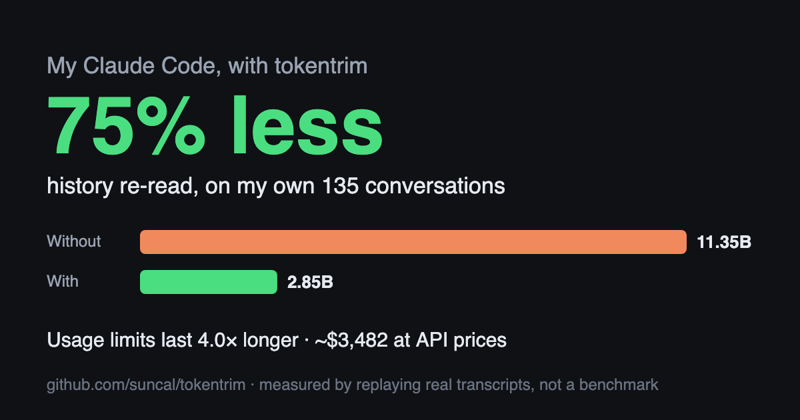

<div align="center">


# tokentrim

**Make Claude Code's usage limits last longer by cutting what it re-reads on every step,<br>measured on your own sessions.**

[](https://github.com/suncal/tokentrim/actions/workflows/tests.yml)
[](LICENSE)
[](#install)
[](#install)
[](https://suncal.github.io/tokentrim/)
[](https://github.com/suncal/tokentrim/stargazers)

[Website](https://suncal.github.io/tokentrim/) · [Quick start](#quick-start) · [The honest numbers](#the-honest-numbers) · [What it changes](#what-it-changes) · [Pro](#pro) · [Discussions](https://github.com/suncal/tokentrim/discussions)



</div>

## Quick start

```bash
git clone https://github.com/suncal/tokentrim && cd tokentrim
bin/tokentrim replay     # your own number, in about a minute; installs nothing
bin/tokentrim install    # if you like the number
```

Undo any time with `bin/tokentrim uninstall`. No dependencies, nothing leaves your machine.

## Why it works

**What you're missing out on without it:** Claude Code re-reads your *whole* conversation on every step. On the author's real usage, 71–75% of that re-reading was avoidable, depending on the profile. Run `bin/tokentrim replay` to get **your own** number in about a minute, before installing anything.

Most "save 90% tokens" tools shrink tool output. That's the wrong target. In an agent loop, about 98% of the input tokens you're billed for are **cache reads**: Claude Code re-sends the *entire* context on every API call. A session carrying 400k tokens of context pays for those 400k again on each step.

tokentrim does three things:

1. **Measures** where your tokens actually went, from the transcripts Claude Code already keeps on your machine.
2. **Keeps context small**: it sets an earlier compaction window and adds hooks that stop screenshots, images, huge files and long command output from bloating it.
3. **Replays** your real past sessions through those rules, so you get your own number instead of a marketing one.

No dependencies (Python 3.9+ stdlib), nothing leaves your machine, and every hook fails open.

## The honest numbers

From the author's 135 real sessions (28,854 API calls, 11.3 billion context tokens), re-measured 20 Oct 2026:

| | context tokens re-sent | cut |
|---|---|---|
| as it happened | 11,349,251,410 | — |
| output trimming only (hooks) | 10,568,885,015 | **6.9%** |
| + `balanced` profile (300k window) | 4,297,754,626 | **62.1%** |
| + `strong` profile (200k window, default) | 3,282,583,187 | **71.1%** |
| + `max` profile (150k window) | 2,853,060,084 | **74.9%** |

Why compaction dominates: the median API call carried **347k tokens** of context. 30 sessions that ran 300+ calls produced 93% of all cache reads. Context grows, and every later step re-pays for all of it.

**Why it isn't 90%:** Claude Code's own system prompt, tool schemas and app instructions are about 40–60k tokens on every call, and no setting removes them. Once sessions are capped, that floor is most of what's left. Anyone promising 90% across *all* work is either measuring a single noisy `npm install` or not measuring.

**Tokens vs. cost:** cache reads are cheap per token (about 0.1× input price), and output tokens aren't touched. So the drop in *billed cost* / usage-limit burn is smaller than the token drop. On the same data it works out to roughly **55–70%**, depending on how much of your cache-write spend comes from cache misses on long sessions.

**The trade-off:** earlier compaction means Claude summarises sooner and forgets detail sooner. `strong` triggers around 150k tokens, which is close to how Claude Code behaved with a 200k window, and is the default. `max` is cheaper but can thrash on sessions that read huge files.

## What it changes

| Rule | Hook | What it does | Lossy? |
|---|---|---|---|
| Compaction window | `env` | `CLAUDE_CODE_AUTO_COMPACT_WINDOW`; compaction fires at ~75% of it (measured) | summarises old turns |
| Screenshots | PreToolUse | Browser `screenshot`/`zoom` (Claude in Chrome, built-in browser, `browser_batch`) get `scale: 0.4`, so **about ⅙ the tokens** (earlier shots in a `browser_batch` get 0.25). Coordinates stay in full-res space. Explicit `scale` and `save_to_disk` are respected | lower-res image |
| Images via Read | PreToolUse | Images over 1024px are downscaled with `sips` to a cached JPEG first | lower-res image |
| Huge files | PreToolUse | Whole-file Read of a file over 40 KB returns an **outline** (defs/headings + line numbers) first. Asking again lets the full read through | no: retry gets everything |
| Long Bash output | PostToolUse | Over 6k chars → head + tail; identical-line runs collapsed; ANSI/progress bars stripped. **Full output spooled to disk**, path included | no: full copy on disk |
| MCP results | PostToolUse | JSON minified, null/empty fields dropped, base64 blobs removed, list items never dropped; over 12k chars clipped with full copy on disk | no: full copy on disk |
| Context meter | UserPromptSubmit | Past 120k tokens, tells **you** (not Claude, 0 tokens) to `/compact` or start fresh | — |
| Guidance | `~/.claude/CLAUDE.md` | ~223 tokens: prefer page text over screenshots, Edit over Write, ranged reads, `lean` / `lean-browser` sub-agents | — |
| Sub-agents | `~/.claude/agents/` | `lean` (file/shell work, 86% fewer tokens than general-purpose in one test) and `lean-browser` (browser jobs: screenshots stay in the sub-agent). Your own files with the same name are never overwritten | — |

## Install

### As a Claude Code plugin (one command)

```bash
claude plugin marketplace add suncal/tokentrim && claude plugin install tokentrim@tokentrim
```

Or inside a session: `/plugin marketplace add suncal/tokentrim`, then `/plugin install tokentrim@tokentrim`. New sessions get:

- the hooks: screenshots, image reads, huge-file outlines, Bash/MCP trimming, context meter
- `/tokentrim:replay [--window N]`: what tokentrim would have saved on your past sessions
- `/tokentrim:dashboard [--no-open]`: the usage and savings dashboard
- `/tokentrim:share [--out DIR]`: your savings card to post
- `/tokentrim:pro [activate KEY | deactivate]`: Pro status, or activate the key from your [Pro](#pro) purchase

The plugin needs `python3` on your PATH and nothing else. Two things a plugin can't do: set the compaction window (`env`) and add the guidance to `~/.claude/CLAUDE.md`. For those, also run `tokentrim install` from a clone (below). It's safe to have both: the plugin's hooks stand down while `tokentrim install` has its hooks in `~/.claude/settings.json`, so nothing runs twice. `tokentrim status` shows which set is active. Remove the plugin with `claude plugin uninstall tokentrim@tokentrim`.

### From a clone

```bash
git clone https://github.com/suncal/tokentrim && cd tokentrim
bin/tokentrim audit                  # where your tokens went
bin/tokentrim replay                 # what tokentrim would have saved, on your sessions
bin/tokentrim install                # strong profile; or --profile balanced|max, --no-guidance
bin/tokentrim status                 # what's installed + recent hook activity
bin/tokentrim serve                  # live dashboard at http://localhost:4747 (--install: keep it running at login)
bin/tokentrim live                   # real-time savings, updating every 2s (--deploy: open it from anywhere)
bin/tokentrim share                  # your savings card as a PNG to post (totals only, nothing private)
bin/tokentrim uninstall              # removes exactly what install added
```

`install` backs up `~/.claude/settings.json` first, keeps all your existing hooks and env, and is idempotent. New sessions pick it up.

Tune any threshold in `~/.config/tokentrim/config.json` (see `tokentrim/config.py`). Two opt-in switches, off by default: `"screenshot_scale_cap": 0.4` caps even an explicit screenshot `scale`, and `"batch_last_shot_only": true` keeps only the last screenshot of a `browser_batch`. Measured numbers: [benchmarks](https://suncal.github.io/tokentrim/benchmarks/). Set `"enabled": false` to switch every hook off instantly.

## Live view

`bin/tokentrim live` opens a real-time view at http://localhost:4747/live: tokens saved today ticking up, saving and re-reading per minute, the last 60 minutes with and without tokentrim, every running conversation's context against where it will be summarised (with a steps-left forecast), live trims as they happen, and plain-English insights.

Want it on your phone? `bin/tokentrim live --deploy` puts the page on your own Cloudflare account (the free plan is enough) behind a private key, and your Mac pushes **totals and project folder names only** every few seconds: no prompts, titles or code. `bin/tokentrim live --link` prints the link again.

### Smart features (change Claude Code from the dashboard)

The live view has switches that write straight into your Claude Code settings. Your own values are saved first and come back when you switch a feature off (or run `tokentrim uninstall`); a model you pick later with `/model` is left alone.

| Switch | What it writes | When it applies |
|---|---|---|
| Smart model: Auto / Sonnet | `model` = `opusplan` (Opus plans, Sonnet does the work) or `sonnet` | new sessions |
| Sub-agent model | `CLAUDE_CODE_SUBAGENT_MODEL` = sonnet or haiku | new sessions |
| Thinking effort | `effortLevel` = medium or low | new sessions |
| Cache lifetime | `promptCacheTtl` = 1h (API-key users; subscriptions already get 1 hour) | new sessions |
| Daily budget guard / hard stop | warns at 80% and 100% of a daily $ cap; hard stop holds prompts (start with `++` to send anyway) | next message |
| Cold-cache alert | back after the cache expired? says what the next message will re-write | next message |
| Model advisor | quick chores on Opus get a "Sonnet does this cheaper" note | next message |

The page shows which Claude Code versions on your Mac read each setting. Older ones silently ignore them, so run `claude update` if it says so. Recommendations come with a one-click **Apply**. Clicks from your phone or the Pro cloud are relayed to your Mac, which only accepts these keys with these values.

There's no per-prompt model switching in Claude Code, so "Auto" is Claude Code's own opusplan plus the cheaper sub-agent model, lower effort and the advisor.

## The dashboard

`bin/tokentrim serve` opens a plain-English dashboard: **with tokentrim vs without it** on your own conversations, what you'd be missing out on, tips, usage by day, every conversation's size over time, and a glossary for the jargon. The details (sources, fixed floor, replay profiles) are one click down. **Share my savings** saves the card above with your numbers.

## Pro

The free tool is the whole token-cutting engine and stays free and open source. **tokentrim Pro** keeps the savings going without you watching a dashboard:

| | Free | Pro |
|---|---|---|
| Hooks, profiles, audit, replay, dashboard, share card | ✓ | ✓ |
| `tokentrim digest`: plain-English weekly report, every Monday | | ✓ |
| `tokentrim budget 2B`: weekly token budget, checked every morning, notification at 80% | | ✓ |
| `tokentrim slack <webhook>`: weekly totals in Slack (opt-in, totals only, test message first) | | ✓ |
| `tokentrim live --cloud`: hosted real-time dashboard with settings relay, sign in with your license key | | ✓ |

**$49 lifetime for the first 500 buyers, then $9/month.** [Get tokentrim Pro](https://buy.polar.sh/polar_cl_f3ynkXOeRekKTm9C62vqBI2C3UGMRz1LgBNAp2GIvva) (checkout by Polar, which handles sales tax). Your license key arrives by email. Activate with `bin/tokentrim pro activate <key>`. The license check sends only your key and a machine label; usage data never leaves your machine. Billing or license help: [support@boltak.com](mailto:support@boltak.com).

**Teams:** a shared dashboard of everyone's spend and savings, with budgets, is in the works. **Paid audit:** want a teardown of where your team's Claude spend goes, with a fix list? Email [support@boltak.com](mailto:support@boltak.com) with "audit" in the subject.

## Pairs well with

- **[graphify](https://github.com/Graphify-Labs/graphify)**: query a code graph instead of grepping. Measured 13k → 130 tokens for "what calls X?" on a 290 KB codebase.
- **[mcpslim](https://github.com/suncal/mcpslim)**: the same JSON shrinking as a standalone MCP proxy, for non-Claude-Code clients.

## Tests

```bash
python3 -m unittest discover -s tests
```

The hooks were also verified live in headless Claude Code 2.1.299 (Bash trimming, outline-first reads, image downscaling, compaction trigger point).

## Contributing

Issues, new rules and real-world numbers are all welcome. See [CONTRIBUTING.md](CONTRIBUTING.md), and post your `replay` result in [Show and tell](https://github.com/suncal/tokentrim/discussions).

## License

[Apache-2.0](LICENSE). Not affiliated with Anthropic.

<div align="center">

**If tokentrim saved you tokens, a ⭐ helps other Claude Code users find it.**

</div>
